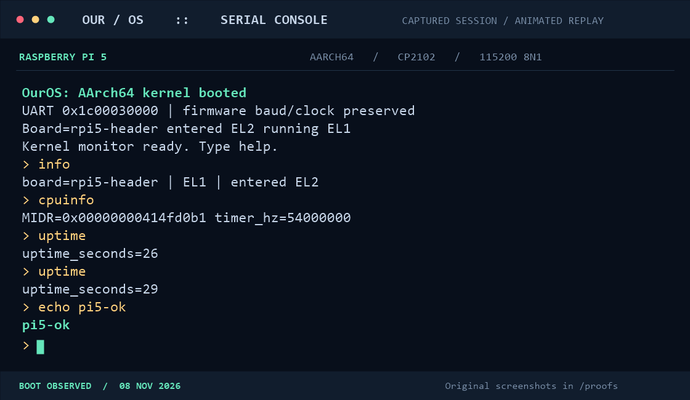
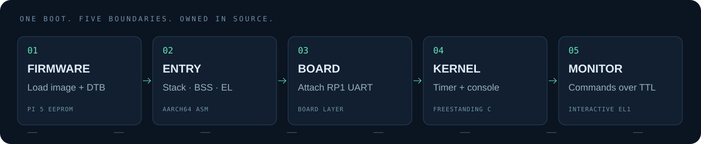

<p align="center">
  
</p>

<p align="center">
  <a href="#the-hardware-receipts">Hardware proof</a> &nbsp; / &nbsp;
  <a href="#boot-it-yourself">Build &amp; boot</a> &nbsp; / &nbsp;
  <a href="#inside-the-kernel">Architecture</a> &nbsp; / &nbsp;
  <a href="#the-next-frontier">Roadmap</a>
</p>

<p align="center">
  
  
  
  
</p>

<p align="center">
  <a href="https://github.com/TharunBabu-05/custom_OS/commits/main"></a>
  <a href="https://github.com/TharunBabu-05/custom_OS/stargazers"></a>
  <a href="https://github.com/TharunBabu-05/custom_OS"></a>
</p>

<h1 align="center">The kernel is on the board.</h1>

<p align="center">
  <strong>An original operating-system kernel, written in C and AArch64 assembly.</strong><br />
  Booted on a physical Raspberry Pi 5. Controlled from a Windows PC through a CP2102 serial adapter.<br />
  Firmware hands over. Our code takes the next instruction.
</p>

> **Hardware milestone · 08 November 2026**
> The Pi 5 header-console build reaches EL1 from EL2, accepts monitor commands,
> reads CPU identification, and reports advancing uptime. This is an early kernel:
> RAM discovery and physical page allocation have also passed the real-Pi test.
> Readable MB/MiB summaries and a writable RAM root also work on the physical Pi.
> The hardware boots from a **32 GB USB pendrive**, without a microSD card.
> Firmware loads the kernel; USB DMA, USB2 BOT endpoint discovery and Wi-Fi
> function-1 identification now pass on the Pi (chip `0x4345`, revision 6).
> Read-only USB sectors, FAT32 `/boot`, CONFIG.TXT reads and transfer/event ring
> cycling now pass on the Pi. Radio core discovery and 800 KiB RAM sizing also
> pass. All 609,309 firmware bytes and packed NVRAM now pass physical
> upload/readback with the radio CPU halted. This phase adds
> [controlled firmware startup](docs/wifi-startup.md), now verified on the Pi.
> The [firmware query channel](docs/wifi-control.md) also passes on the Pi
> (firmware 7.45.265). [Capability and CLM/country setup](docs/wifi-prepare.md)
> also pass for IN / revision 0. [Passive scanning](docs/wifi-scan.md) now finds
> Jack's with SAE and required PMF. New [crypto/RNG foundations](docs/wifi-auth-foundation.md)
> now pass their physical random-source test. The [WPA3 target checks](docs/wifi-target.md)
> inspect exact cipher/AKM/PMF and RSNXE advertisements before authentication,
> and now pass on the Pi. [P-256 math](docs/wifi-p256.md) also passes twice on
> hardware. [H2E derivation](docs/wifi-h2e.md) now passes on the Pi too. The next
> [in-memory SAE exchange](docs/wifi-sae.md) also passes on the Pi. The next
> [external-auth transport stage](docs/wifi-auth-transport.md) adds frame/event
> encoding and a reversible firmware policy check before radio authentication.
> WPA3-Personal is the requested connection target;
> SAE, association, M2/M3, key SET/deletion ACKs, authenticated M3 retries and
> live M4 writes now pass on hardware. Corrected M4/key ordering, peer-port
> authorization/readback and DHCP OFFER/ACK also pass, with two successful decryptions.
> Address checks, ARP and all three gateway replies also pass. The previous
> test disconnected deliberately; the new foreground session needs a Pi run;
> persistent IP and Internet access remain unfinished.
> On a fresh boot run `storageinit` before `usbtest`/`usbenum`. The USB block
> driver supplies the next dependency for reading Wi-Fi firmware from disk.

## The hardware receipts

Complete disk image backups are saved directly in `image_files` with readable
phase names. The newest header image is `OurOS-Pi5-header-experimental-sd.img`.
Builds preserve previous versions before cleaning stale output. See
[image backups and cleanup](docs/image-archive.md).

**Download the complete flashable image:**
[Pi 5 header-console disk ZIP](image_files/OurOS-Pi5-header-experimental-sd.zip).
Extract the `.img` before flashing your pendrive. Every completed disk-image
build now creates a verified ZIP for GitHub; raw 128 MiB images stay local.
The [latest Pi transcript](proofs/pi5-gateway-three-replies-2026-11-11.txt)
passes DHCP, address checks, gateway ARP and all three ICMP replies, with normal
deauthorization/DOWN cleanup afterward.

The new [`wificonnect` phase](docs/wifi-session.md) keeps that connection open
in a foreground `net>` console. It services RX/ARP while idle and supports
gateway/off-link numeric pings, status and explicit disconnect. Lease expiry,
unsupported rekey or link failure closes it. The page bitmap moves from kernel
BSS into separately reserved RAM to make room for networking. Native models
cover these changes; the new session and external reachability need a Pi test.
DNS, renewal/rekey, background networking and package installation remain.
Type credentials only at the hidden prompt; none are saved or embedded.
Current development images stay local; the user handles GitHub publication.
<p align="center">
  
  <br />
  <sub>Animated illustration of the captured session. Some output is shortened for readability; timing is illustrative. Original proof screenshots are below.</sub>
</p>

<details>
<summary><strong>Prefer a still image? Open the static console illustration.</strong></summary>


</details>

<table>
  <tr>
    <td width="33%" valign="top"><strong>01 / Firmware loads</strong><br /><br /><a href="proofs/Screenshot%202026-11-08%20154310.png"></a><br /><sub>The boot firmware finds the image and device tree.</sub></td>
    <td width="33%" valign="top"><strong>02 / Our code starts</strong><br /><br /><a href="proofs/Screenshot%202026-11-08%20154352.png"></a><br /><sub>The kernel prints its own banner and opens the monitor.</sub></td>
    <td width="33%" valign="top"><strong>03 / Commands respond</strong><br /><br /><a href="proofs/Screenshot%202026-11-08%20154407.png"></a><br /><sub>Serial input, CPU registers and the timer are accessible.</sub></td>
  </tr>
</table>

<p align="center"><sub>Click any original screenshot to inspect it at full resolution.</sub></p>

| Captured on real hardware | Observed result |
| :--- | :--- |
| Board build | `rpi5-header` · Raspberry Pi 5 · Cortex-A76 |
| Privilege transition | Entered **EL2**, running **EL1** |
| CPU identification | `MIDR=0x00000000414fd0b1` |
| Physical counter frequency | `54,000,000 Hz` |
| Console | RP1 UART0 · `0x1c00030000` · 115200 8N1 |
| Firmware device-tree pointer | `0x0000000000200000` |
| Timer advancement | `uptime_seconds=26` → `29` |
| Command round trip | `echo pi5-ok` → `pi5-ok` |

[Hardware verification record](docs/pi5-hardware-verification.md) · [Original proofs](proofs/) · [Development log](docs/development-log.md)

<details>
<summary><strong>Later hardware milestones: memory and writable RAM files</strong></summary>


These captures verify the earlier memory and RAMFS revisions. They do not
establish that the new Pi SD-card handoff or Wi-Fi query has passed.

</details>

## Inside the kernel

<p align="center">
  
</p>

OurOS uses a modular monolithic design. Board code selects the hardware interface;
shared kernel code implements the console, timer access and command monitor.
The current monitor runs in privileged EL1, with one active core and the MMU off.

| Working today | Implementation |
| :--- | :--- |
| AArch64 entry | Stack setup, BSS clearing, masked exceptions and EL1/EL2 handoff |
| Early diagnostics | Fatal exception vectors with register output |
| Serial console | Polling PL011; firmware-preserved RP1 UART setup on the tested Pi |
| Device-tree subset | Bounded UART/clock/RAM discovery for **QEMU virt** |
| Time and CPU | Architectural counter reads, uptime and MIDR inspection |
| Physical memory | DTB RAM/reservations and 4 KiB pages, also observed on the real Pi |
| Root filesystem | Writable RAMFS with paths and monitor commands, also observed on the real Pi |
| Storage | USB BOT capacity/sectors and FAT32 `/boot` observed on Pi, including reads after ring wrap; virtio tested in QEMU |
| USB | Pi DMA/descriptors observed; configuration, bulk/event ring cycling and SCSI reads tested in QEMU |
| Wi-Fi groundwork | SAE, keys, peer authorization and DHCP ACK observed on Pi; address checks/ARP/gateway ping added; persistent networking remains |
| Kernel monitor | Line editing, command dispatch, echo and overflow recovery |
| Image tooling | Native PowerShell packaging, MBR/FAT32 generation and independent extraction checks |
| Emulator validation | A53/A76 monitor tests, EL1/EL2 handoff, fatal faults and GDB startup checks |

The FAT32 boot partition is read by the Pi firmware. Our kernel creates a
separate [RAM root filesystem](docs/ramfs.md). `storageinit` attempts a read-only
[FAT32 mount at /boot](docs/storage.md) from SD handoff or experimental USB2 BOT
on Pi, and virtio or USB on QEMU. Follow the [pendrive test](docs/usb.md) on a
fresh boot; the latest Pi capture verifies capacity, sectors and file reads.
[Physical memory](docs/memory.md) and RAMFS
have hardware evidence; Pi SD reads still need their own test. MMU, heap and user
processes remain unfinished. [Wi-Fi diagnostics](docs/wifi.md) do not provide a connection.

<details>
<summary><strong>Explore the source map</strong></summary>

```text
arch/aarch64/       CPU entry and exception vectors
boards/            Raspberry Pi 5 and QEMU board initialization
boot/rpi5/         Firmware config, asset pins and boot-file notes
drivers/           PL011 UART and architectural timer
kernel/core/       Monitor, console and QEMU device-tree reader
kernel/memory/     RAM/reservations and physical page allocation
filesystem/        Bounded RAM root filesystem
include/           Internal interfaces
lib/               Freestanding memory helpers
linker/            Board memory layouts
scripts/           Native Windows builds, image generation and checks
tests/             Toolchain probes and host-side device-tree tests
proofs/            Original screenshots from the physical Pi 5
docs/              Architecture, evidence, guides and generated artwork
```

Some additional directories reserve space for future subsystems. Their presence
does not imply those drivers or services are implemented.

</details>

## Boot it yourself

The primary workflow runs on **native Windows PowerShell**. WSL is optional.
The setup script downloads and verifies the pinned portable GNU AArch64 tools,
QEMU and extraction utilities into the ignored `.dist/` directory.

```powershell
git clone https://github.com/TharunBabu-05/custom_OS.git
cd custom_OS
powershell -NoProfile -ExecutionPolicy Bypass -File scripts/setup-windows.ps1
powershell -NoProfile -ExecutionPolicy Bypass -File scripts/build.ps1 -Target virt
powershell -NoProfile -ExecutionPolicy Bypass -File scripts/run-qemu.ps1
```

At the monitor, try `help`, `meminfo`, `pwd`, `ls /`, `cat /README.txt`, or `fsinfo`.
Files are volatile and return to their initial contents after reboot.

<details>
<summary><strong>Build the physically tested Pi 5 header-console variant</strong></summary>

```powershell
powershell -NoProfile -ExecutionPolicy Bypass -File scripts/image-rpi5.ps1 -Console header
```

Generated whole-card image:

```text
build/rpi5-header/OurOS-Pi5-header-experimental-sd.img
```

| CP2102 connection | Pi 5 physical header pin |
| :--- | :--- |
| RXD | **8** · GPIO14 · Pi TX |
| TXD | **10** · GPIO15 · Pi RX |
| GND | **6** · Ground |

Use 3.3 V UART logic and leave adapter power pins disconnected. Power the Pi
through USB-C. Terminal: **115200 / 8N1 / no flow control**.

The current header build uses the firmware mapping captured on the tested board,
`0x1c00030000`. Other firmware mappings require separate verification. The default
build uses the small UART10 connector and has not been physically tested.

Generated images and downloaded tools are excluded from Git. Build the image
locally; no hosted binary release is claimed here. Choose your intended SD card
carefully when flashing because writing an image replaces its existing contents.

[Full wiring and boot guide](docs/rpi5-header-uart.md) · [Disk-image guide](docs/disk-image.md)

</details>

<details>
<summary><strong>Run the available verification checks</strong></summary>

```powershell
powershell -NoProfile -ExecutionPolicy Bypass -File scripts/test-qemu.ps1
powershell -NoProfile -ExecutionPolicy Bypass -File scripts/test-gdb.ps1
powershell -NoProfile -ExecutionPolicy Bypass -File scripts/test-fdt.ps1
powershell -NoProfile -ExecutionPolicy Bypass -File scripts/test-memory.ps1
powershell -NoProfile -ExecutionPolicy Bypass -File scripts/test-ramfs.ps1
powershell -NoProfile -ExecutionPolicy Bypass -File scripts/test-storage.ps1
powershell -NoProfile -ExecutionPolicy Bypass -File scripts/test-usb.ps1
powershell -NoProfile -ExecutionPolicy Bypass -File scripts/test-wifi.ps1
powershell -NoProfile -ExecutionPolicy Bypass -File scripts/test-usb-qemu.ps1
powershell -NoProfile -ExecutionPolicy Bypass -File scripts/build.ps1 -Target handoff-test
powershell -NoProfile -ExecutionPolicy Bypass -File scripts/test-qemu.ps1 -Handoff
powershell -NoProfile -ExecutionPolicy Bypass -File scripts/test-rpi5-image.ps1 -Console header
```

Build the corresponding QEMU kernel or Pi image first. The additional host-side
DTB tests use MSYS2 GCC; see [the Windows guide](docs/windows.md) for prerequisites.
QEMU virt tests shared code and does not emulate the Pi 5's RP1 hardware.

</details>

## Three targets. Explicit boundaries.

| Target | CPU | Current state |
| :--- | :--- | :--- |
| **Raspberry Pi 5** | BCM2712 · Cortex-A76 · AArch64 | Header-console kernel boot and commands observed on hardware |
| **QEMU virt** | Cortex-A53 / Cortex-A76 | Shared startup, monitor and diagnostics tested in emulation |
| **Raspberry Pi Zero 2 W** | BCM2710A1 · Cortex-A53 · 512 MB | Planned physical port; compiler probe only |

## The next frontier

- [x] Native Windows cross-build and QEMU bring-up
- [x] EL1 startup, serial monitor and fatal exception diagnostics
- [x] Firmware-style EL1/EL2 handoff tests
- [x] Whole-card experimental Pi 5 image generation
- [x] Real Pi 5 header UART boot, CPU information, echo and advancing uptime
- [x] Memory discovery, reservations and physical pages: host/QEMU tests
- [x] Physical Pi memory validation: pattern tests, allocation and release
- [x] RAM root filesystem and file commands: host/QEMU tests
- [x] Physical Pi validation of the RAMFS and MB/MiB revision
- [x] Read-only FAT32, mount routing and QEMU block reads
- [x] Physical Pi USB BOT sectors, FAT32 files and bulk/event ring cycling
- [x] Physical Pi Wi-Fi SDIO and ChipCommon identification
- [x] Physical Pi Wi-Fi core map, 800 KiB RAM and selector restoration
- [x] Physical Pi firmware upload/readback with CR4 halted
- [x] Physical Pi firmware startup and shared-memory initialization
- [x] Physical Pi read-only FullMAC control replies (firmware 7.45.265)
- [x] Physical Pi capability/CLM/country IN verification
- [x] Physical Pi passive scan/events including SAE + required PMF hotspot
- [x] Physical Pi RNG source and live SAE peer confirmation
- [x] Physical Pi association and EAPOL M2/M3 MIC/unwrap verification
- [x] Physical Pi authenticated key-data validation and offline M4
- [x] Physical Pi firmware key installation/live M4 with authenticated M3 retries
- [x] Physical Pi peer-port authorization/readback and DHCP DORA
- [x] Physical Pi address checks, ARP and three gateway ICMP replies
- [ ] Physical Pi foreground session and numeric external ping (new revision)
- [ ] Persistent supplicant, group rekey, lease renewal and external IP networking
- [ ] Physical Pi SD-card handoff
- [ ] Interrupt controller, timer interrupts and virtual memory
- [ ] Scheduling, EL0 processes and a syscall interface
- [ ] VFS, storage and persistent filesystems
- [ ] GPIO, display, USB input and networking
- [ ] Pi Zero 2 W physical bring-up and later multicore support

<p align="center">
  
</p>

<details>
<summary><strong>Documentation, artwork and licensing</strong></summary>

- [Architecture and milestones](docs/architecture.md)
- [Native Windows workflow](docs/windows.md)
- [First kernel implementation](docs/first-kernel.md)
- [Pi board and firmware integration](docs/boards.md)
- [Hardware verification](docs/pi5-hardware-verification.md)
- [Memory subsystem and commands](docs/memory.md)
- [RAM root filesystem and commands](docs/ramfs.md)
- [Storage reads and the FAT32 mount](docs/storage.md)
- [USB pendrive roadmap and controller discovery](docs/usb.md)
- [Wi-Fi bring-up status](docs/wifi.md)
- [OS, CPU architectures and portability explained](docs/os-and-cpu-architectures.md)
- [Asset sources and regeneration](docs/assets/README.md)

The original kernel and artwork do not yet have a selected public license.
Availability of the source is not an unrestricted-use grant. Downloaded vendor
assets retain their upstream notices and are excluded from this Git repository.
The boot DTB is Linux-derived; retain its GPL notices and address corresponding
source requirements before publicly distributing a binary boot bundle.

The animated replay is an original illustration of captured output. Hardware
proof images in `proofs/` are the original user-supplied screenshots. Live commit,
star and language badges are supplied by Shields.io; core artwork is hosted in
this repository. GitHub renders this README as Markdown and images, with no
JavaScript required.

</details>

<p align="center"><sub>Built by <a href="https://github.com/TharunBabu-05">TharunBabu-05</a> · C / AArch64 / curiosity · Every milestone needs evidence.</sub></p>
