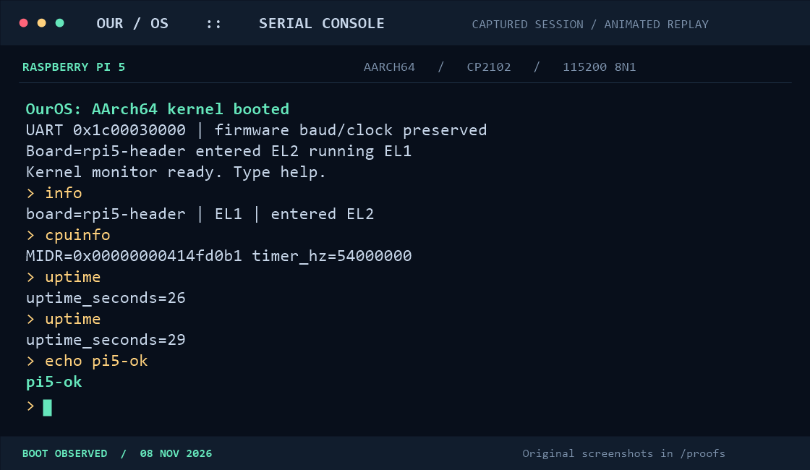
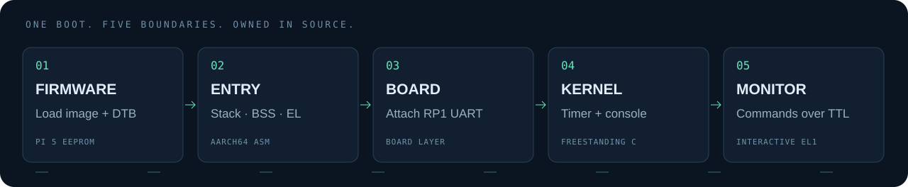

<p align="center">
  
</p>

<p align="center">
  <a href="#the-hardware-receipts">Hardware proof</a> &nbsp; / &nbsp;
  <a href="#boot-it-yourself">Build &amp; boot</a> &nbsp; / &nbsp;
  <a href="#inside-the-kernel">Architecture</a> &nbsp; / &nbsp;
  <a href="#the-next-frontier">Roadmap</a>
</p>

<p align="center">
  
  
  
  
</p>

<p align="center">
  <a href="https://github.com/TharunBabu-05/custom_OS/commits/main"></a>
  <a href="https://github.com/TharunBabu-05/custom_OS/stargazers"></a>
  <a href="https://github.com/TharunBabu-05/custom_OS"></a>
</p>

<h1 align="center">The kernel is on the board.</h1>

OurOS is an original AArch64 operating system written in C and assembly.
On the tested Raspberry Pi 5, it boots from USB into a serial shell, mounts
read-only `/boot` and persistent `/data`, and enables MMU protection and the
timer. Run `df` in the shell to inspect the mounts, `exit` to reach the kernel
monitor, or `startup` at the monitor to reopen the shell.
[Boot and update guide](docs/boot-updates-tharun_verified.md)

The current build produces **94 userland ELF programs**. The OurOS syscall ABI
defines **102 syscall IDs (0–101)**, including demand-paged reservations.
The kernel supports **8 foreground process slots and 3 supervised service
slots**, nested process trees, named IPC, and pipelines of up to 7 stages.
[Application build list](scripts/build-apps.ps1) · [Syscall ABI](include/user_abi.h) ·
[Process limits](include/process.h)

## The hardware receipts

| Verified on Raspberry Pi 5 | Recorded result |
| :--- | :--- |
| Core process model | `CORECHK.ELF` passed shared memory, permission-limited descriptor transfer, timed blocking, signals, fault reporting, and cleanup. Later runs verified nested process trees, named IPC, seven-stage binary pipelines, and three supervised services. [CORECHK](proofs/pi5-core-os-2026-11-24.txt) · [Process trees](proofs/pi5-process-trees-2026-11-25.txt) · [Named IPC](proofs/pi5-named-ipc-2026-11-26.txt) · [Pipelines and jobs](proofs/pi5-core-smp-vm-dma-2026-11-27.txt) · [Services](proofs/pi5-services-2026-11-26.txt) |
| Secondary CPU workers, phases 41–46 | The Pi started three EL1 workers and exercised GICv2 SGIs, shared work queues, TLB invalidation, and page leases. A separate GICv2 test verified peripheral SPIs and deferred handlers. [Worker milestones](docs/secondary-cpus.md) · [SGI capture](proofs/pi5-interprocessor-irqs-2026-11-26.txt) · [Page leases](proofs/pi5-smp-page-leases-2026-11-26.txt) · [Peripheral IRQs](proofs/pi5-peripheral-irqs-2026-11-22.txt) |
| Multicore EL0 and memory, phase 63 | Three secondary CPUs ran EL0 slices concurrently. Demand-zero paging, all remap stages across four cores, and two cache-maintained RP1 DMA transfers passed. The multicore shell reaped all 23 children and resource claims returned to baseline. [Pi capture](proofs/pi5-core-smp-vm-dma-2026-11-27.txt) |
| Wired Ethernet and DHCP | The Gigabit-capable RP1 GEM driver passed link negotiation, ARP, ICMP, UDP, and outbound TCP on the tested 100 Mbps link. Both endpoints matched the 16 KiB TCP echo digest, and the Pi received the final reply after a write half-close. The Pi bound a wired DHCP lease and the Windows fixture logged three renewal ACKs. [IPv4](proofs/pi5-ethernet-ipv4-pass-2026-11-24.txt) · [TCP and UDP](proofs/pi5-gem-tx-ring-2026-11-27.txt) · [DHCP](proofs/pi5-wired-dhcp-bound-2026-11-27.txt) |
| Wi-Fi and TLS 1.3 | WPA3/SAE, DHCP, DNS, Internet ICMP, and automatic hotspot reconnection have Pi evidence. `TLSCHK.ELF` passed handshake transcript checks, `TLSECHO.ELF` completed a pinned TLS 1.3 encrypted echo, and `PKGGET.ELF` downloaded and verified an ELF over HTTPS. [Wi-Fi and DNS](proofs/pi5-dns-hostname-ping-clean-disconnect-2026-11-12.txt) · [Reconnect](proofs/pi5-hotspot-reconnect-2026-11-22.txt) · [TLS transcript](proofs/pi5-tls-transcript-2026-11-22.txt) · [Live TLS](docs/tls-live.md#local-verification) · [HTTPS download](proofs/pi5-package-download-2026-11-22.txt) |
| Persistent storage and apps | The USB-backed v5 filesystem retained files and installed apps across a cold power cycle. The Pi also verified named-app install, upgrade, rollback, and uninstall, plus signed multi-file packages and dependencies. On spare media it imported a v4 archive, recovered the last committed v5 generation after a physical power cut, and committed a new write. [Storage and apps capture](proofs/pi5-storage-apps-2026-11-24.txt) · [Migration and power cut](proofs/pi5-storage-migration-power-cut-2026-11-27.txt) |

See the [Pi capture index](proofs/README.md) for the recorded test results and
the [remaining roadmap](docs/remaining-os-roadmap.md) for open work.

The repository includes an [archived Pi 5 header-console disk ZIP](image_files/OurOS-Pi5-header-experimental-sd.zip).
Extract the `.img` before flashing. To reproduce the current source build, use
the Pi build command below. [Image archive and cleanup](docs/image-archive.md)
<p align="center">
  
  <br />
  <sub>Animated illustration of the captured session. Some output is shortened for readability; timing is illustrative. Original proof screenshots are below.</sub>
</p>

<details>
<summary><strong>Prefer a still image? Open the static console illustration.</strong></summary>


</details>

<table>
  <tr>
    <td width="33%" valign="top"><strong>01 / Firmware loads</strong><br /><br /><a href="proofs/Screenshot%202026-11-08%20154310.png"></a><br /><sub>The boot firmware finds the image and device tree.</sub></td>
    <td width="33%" valign="top"><strong>02 / Our code starts</strong><br /><br /><a href="proofs/Screenshot%202026-11-08%20154352.png"></a><br /><sub>The kernel prints its own banner and opens the monitor.</sub></td>
    <td width="33%" valign="top"><strong>03 / Commands respond</strong><br /><br /><a href="proofs/Screenshot%202026-11-08%20154407.png"></a><br /><sub>Serial input, CPU registers and the timer are accessible.</sub></td>
  </tr>
</table>

<p align="center"><sub>Click any original screenshot to inspect it at full resolution.</sub></p>

| Captured on real hardware | Observed result |
| :--- | :--- |
| Board build | `rpi5-header` · Raspberry Pi 5 · Cortex-A76 |
| Privilege transition | Entered **EL2**, running **EL1** |
| CPU identification | `MIDR=0x00000000414fd0b1` |
| Physical counter frequency | `54,000,000 Hz` |
| Console | RP1 UART0 · `0x1c00030000` · 115200 8N1 |
| Firmware device-tree pointer | `0x0000000000200000` |
| Timer advancement | `uptime_seconds=26` → `29` |
| Command round trip | `echo pi5-ok` → `pi5-ok` |

[Hardware verification record](docs/pi5-hardware-verification.md) · [Original proofs](proofs/) · [Development log](docs/development-log.md)

<details>
<summary><strong>Later hardware milestones: memory and writable RAM files</strong></summary>


These early captures show the physical page allocator and RAMFS before the
later storage, networking, and user-mode tests.

</details>

## Inside the kernel

<p align="center">
  
</p>

OurOS uses a modular monolithic kernel. The monitor and device drivers run
on the boot CPU. The normal serial shell schedules EL0 there. After
`smpstart` and `smpirq on`, `appmulti` and `appsmpshell` run EL0 slices on
secondary CPUs, with syscalls, drivers, and page ownership serialized on
the boot CPU. Kernel tasks use cooperative EL1 scheduling.
[Multicore scheduling and memory](docs/core-vm-smp.md) ·
[Kernel tasks](docs/kernel-tasks.md)

| Subsystem | Implementation |
| :--- | :--- |
| Boot and interrupts | AArch64 EL1/EL2 entry, device-tree discovery, GICv2, architectural timer, peripheral SPI dispatch, and SGIs |
| Memory and isolation | 4 KiB physical pages, small-object kernel heap, protected kernel and user mappings, private ELF address spaces, file-backed snapshots, shared mappings, demand-zero pages, and broadcast TLB invalidation |
| Processes and IPC | ELF loading and exec, nested process trees, weighted EL0 scheduling, named IPC, descriptor passing, signals, fault records, and timed waits |
| Shell and services | Interactive serial shell, redirected I/O, seven-stage pipelines, four shell jobs, three supervised service slots, and checked file and socket descriptors |
| Filesystems and storage | Writable RAMFS at `/`, read-only FAT32 at `/boot`, and USB-backed v5 extents at `/data` with up to 32 nodes and 32 KiB per file. The kernel also supports older data formats and explicit v4 archive import into v5. |
| Networking | WPA3/SAE station sessions, RP1 Ethernet, DHCP, ARP, IPv4, ICMP and DNS, UDP sockets, and bounded outbound TCP with half-close. User applications exercise pinned P-256 TLS 1.3 and HTTPS downloads. |
| Packages | Managed ELF versions with rollback, and a signed multi-file repository with dependency validation and installer commands |
| Platform drivers | PL011, timer and GICv2, USB xHCI/BOT and boot-keyboard reports, microSD reads, GPIO diagnostics, PCIe and RP1 diagnostics, and an opt-in HDMI framebuffer console |

### Source map

| Path | What lives there |
| :--- | :--- |
| [`arch/aarch64/`](arch/aarch64/) | CPU entry, exception vectors, MMU control, context switching, and secondary CPU bring-up |
| [`boards/`](boards/) | Pi 5 and QEMU board setup |
| [`boot/rpi5/`](boot/rpi5/) | Firmware configuration, device-tree asset pins, and boot notes |
| [`drivers/`](drivers/) | UART, timer, interrupts, xHCI and USB storage, SD/SDIO, radio, RNG, and framebuffer |
| [`drivers/platform/`](drivers/platform/) | Pi firmware mailbox and health queries, PCIe, RP1 discovery, GEM Ethernet, DMA, and MSI-X diagnostics |
| [`filesystem/`](filesystem/) | VFS, RAMFS, FAT32, and persistent snapshot and extent formats |
| [`kernel/core/`](kernel/core/) | Monitor and console commands, boot and storage setup, app management, and package installation |
| [`kernel/memory/`](kernel/memory/) | Physical page allocation, kernel heap, MMU table policy, and SMP page leases |
| [`kernel/process/`](kernel/process/) and [`kernel/scheduler/`](kernel/scheduler/) | ELF loader, process and syscall handling, user memory, scheduling policy, kernel tasks, and network worker |
| [`include/`](include/) | Kernel interfaces and the OurOS user syscall ABI |
| [`lib/`](lib/) | Freestanding memory and crypto, WPA3/SAE primitives, TLS 1.3, and HTTP download parsing |
| [`network/`](network/) | Ethernet/IPv4 data paths, ARP/ICMP, DHCP, DNS, and UDP and TCP socket engines |
| [`user/applications/`](user/applications/) | EL0 shell, commands, utilities, demos, and acceptance programs |
| [`user/runtime/`](user/runtime/) | ELF entry and linker layout, syscall wrappers, allocation, and reusable file, stream, and network helpers |
| [`linker/`](linker/) | Kernel image and memory layouts |
| [`scripts/`](scripts/) and [`tests/`](tests/) | Build, image, and update tooling, plus host and emulator tests |
| [`proofs/`](proofs/) and [`docs/`](docs/) | Pi captures, architecture, driver status, and developer guides |

## Boot it yourself

The primary workflow runs on **native Windows PowerShell**. WSL is optional.
The setup script downloads and verifies the pinned portable GNU AArch64 tools,
QEMU and extraction utilities into the ignored `.dist/` directory.

```powershell
git clone https://github.com/TharunBabu-05/custom_OS.git
cd custom_OS
powershell -NoProfile -ExecutionPolicy Bypass -File scripts/setup-windows.ps1
powershell -NoProfile -ExecutionPolicy Bypass -File scripts/build.ps1 -Target virt
powershell -NoProfile -ExecutionPolicy Bypass -File scripts/run-qemu.ps1
```

At the monitor, try `help`, `meminfo`, `pwd`, `ls /`, `cat /README.txt`, or `fsinfo`.
Files are volatile and return to their initial contents after reboot.

<details>
<summary><strong>Build the physically tested Pi 5 header-console variant</strong></summary>

```powershell
powershell -NoProfile -ExecutionPolicy Bypass -File scripts/image-rpi5.ps1 -Console header -DataVersion 5 -KeepBuildFiles
```

Generated whole-card image:

```text
build/rpi5-header/OurOS-Pi5-header-experimental-sd.img
```

| CP2102 connection | Pi 5 physical header pin |
| :--- | :--- |
| RXD | **8** · GPIO14 · Pi TX |
| TXD | **10** · GPIO15 · Pi RX |
| GND | **6** · Ground |

Use 3.3 V UART logic and leave adapter power pins disconnected. Power the Pi
through USB-C. Terminal: **115200 / 8N1 / no flow control**.

The current header build uses the firmware mapping captured on the tested board,
`0x1c00030000`. Other firmware mappings require separate verification. The default
build uses the small UART10 connector and has not been physically tested.

Build the current disk image locally. Flash it to the intended USB drive or
SD card after checking the target, since flashing replaces the drive contents.

[Full wiring and boot guide](docs/rpi5-header-uart.md) · [Disk-image guide](docs/disk-image.md)

</details>

<details>
<summary><strong>Run the available verification checks</strong></summary>

```powershell
powershell -NoProfile -ExecutionPolicy Bypass -File scripts/test-qemu.ps1
powershell -NoProfile -ExecutionPolicy Bypass -File scripts/test-gdb.ps1
powershell -NoProfile -ExecutionPolicy Bypass -File scripts/test-fdt.ps1
powershell -NoProfile -ExecutionPolicy Bypass -File scripts/test-memory.ps1
powershell -NoProfile -ExecutionPolicy Bypass -File scripts/test-ramfs.ps1
powershell -NoProfile -ExecutionPolicy Bypass -File scripts/test-storage.ps1
powershell -NoProfile -ExecutionPolicy Bypass -File scripts/test-usb.ps1
powershell -NoProfile -ExecutionPolicy Bypass -File scripts/test-wifi.ps1
powershell -NoProfile -ExecutionPolicy Bypass -File scripts/test-usb-qemu.ps1
powershell -NoProfile -ExecutionPolicy Bypass -File scripts/build.ps1 -Target handoff-test
powershell -NoProfile -ExecutionPolicy Bypass -File scripts/test-qemu.ps1 -Handoff
powershell -NoProfile -ExecutionPolicy Bypass -File scripts/test-rpi5-image.ps1 -Console header
```

Build the corresponding QEMU kernel or Pi image first. The additional host-side
DTB tests use MSYS2 GCC; see [the Windows guide](docs/windows.md) for prerequisites.
QEMU virt tests shared code and does not emulate the Pi 5's RP1 hardware.

</details>

## Three targets. Explicit boundaries.

| Target | CPU | Current state |
| :--- | :--- | :--- |
| **Raspberry Pi 5** | BCM2712 · Cortex-A76 · AArch64 | USB boot, serial shell, multicore EL0, v5 storage, and networking verified on the header-console build |
| **QEMU virt** | Cortex-A53 / Cortex-A76 | Shared kernel, storage, process, and SMP test suites exercised in emulation |
| **Raspberry Pi Zero 2 W** | BCM2710A1 · Cortex-A53 · 512 MB | Planned physical port; compiler probe only |

## The next frontier

### Passed on Raspberry Pi 5

- [x] USB boot to the serial shell with MMU protection, GICv2 timer IRQs, and protected EL0 programs.
- [x] Eight foreground slots, three supervised service slots, nested processes, named IPC, descriptor passing, and the `CORECHK.ELF` suite.
- [x] Seven-stage binary pipelines, four background shell jobs, and multicore EL0 execution in `appsmpshell`.
- [x] Secondary-core bring-up, SGIs and peripheral SPIs, shared work queues, worker page leases, general user-mapping TLB shootdown, demand paging, and cached RP1 DMA diagnostics.
- [x] USB-backed v5 cold retention, v4 archive import and physical power-cut recovery on spare media, named-app lifecycle, and signed packages with dependencies.
- [x] WPA3 Wi-Fi and hotspot reconnect, wired DHCP activation, UDP and outbound TCP echo, pinned TLS 1.3 echo, and HTTPS package download.
- [x] Read-only microSD sector reads and USB boot-keyboard report detection. [microSD capture](proofs/pi5-microsd-tail-2026-11-24.txt) · [Keyboard capture](proofs/pi5-usb-keyboard-port-2026-11-24.txt)

### Open engineering work

- [ ] Extend multicore scheduling to services and broader driver concurrency, with per-CPU run queues and IRQ affinity.
- [ ] Expand kernel image headroom beyond the current firmware handoff layout.
- [ ] Wire USB HID input into the shell and verify the HDMI console on a physical display.
- [ ] Verify wired Gigabit negotiation, add network route selection, and capture DHCP rebinding and lease-loss cases on hardware.
- [ ] Automate host and QEMU regression tests in GitHub Actions.
- [ ] Continue remaining peripheral drivers and Pi Zero 2 W bring-up.

[Detailed roadmap](docs/remaining-os-roadmap.md) · [Hardware driver plan](docs/platform-driver-plan.md)

<details>
<summary><strong>Documentation, artwork and licensing</strong></summary>

- [Architecture and milestones](docs/architecture.md)
- [Native Windows workflow](docs/windows.md)
- [First kernel implementation](docs/first-kernel.md)
- [Pi board and firmware integration](docs/boards.md)
- [Hardware verification](docs/pi5-hardware-verification.md)
- [Memory subsystem and commands](docs/memory.md)
- [RAM root filesystem and commands](docs/ramfs.md)
- [Storage reads and the FAT32 mount](docs/storage.md)
- [USB pendrive roadmap and controller discovery](docs/usb.md)
- [Wi-Fi bring-up status](docs/wifi.md)
- [OS, CPU architectures and portability explained](docs/os-and-cpu-architectures.md)
- [Asset sources and regeneration](docs/assets/README.md)

The original kernel and artwork do not yet have a selected public license.
Availability of the source is not an unrestricted-use grant. Downloaded vendor
assets retain their upstream notices and are excluded from this Git repository.
The boot DTB is Linux-derived; retain its GPL notices and address corresponding
source requirements before publicly distributing a binary boot bundle.

The animated replay is an original illustration of captured output. Hardware
proof images in `proofs/` are the original user-supplied screenshots. Live commit,
star and language badges are supplied by Shields.io; core artwork is hosted in
this repository. GitHub renders this README as Markdown and images, with no
JavaScript required.

</details>

<p align="center"><sub>Built by <a href="https://github.com/TharunBabu-05">TharunBabu-05</a> · C / AArch64 / curiosity · Every milestone needs evidence.</sub></p>
