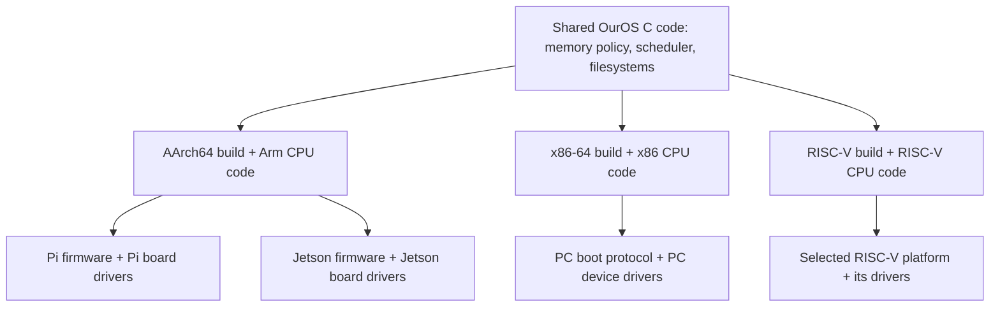

# CPUs, operating systems and portable images

OurOS currently targets **AArch64**, the 64-bit Arm instruction set used by the
Pi 5's Cortex-A76 and Zero 2 W's Cortex-A53. Architecture describes how a CPU
executes software; it is not an operating system running underneath our kernel.

## Five different layers

| Layer | Meaning | This project |
| --- | --- | --- |
| Instruction set architecture (ISA) | Machine instructions, registers, privilege and memory rules | AArch64 |
| CPU implementation | A processor core that implements that ISA | Cortex-A76 on Pi 5 |
| SoC and board | CPU plus memory controllers, UARTs, interrupts, USB and wiring | BCM2712 + RP1 on Raspberry Pi 5 |
| Firmware and boot contract | Early initialization and how control reaches the kernel | Pi EEPROM, embedded Arm stub, kernel Image + DTB |
| OS kernel and applications | Memory, tasks, protection, drivers, files and programs | Our original kernel; applications are future work |

Arm defines CPU architectural behaviour and also licenses processor technology
to chip designers. That business is distinct from writing programs which run
on already manufactured Arm hardware. Public architecture/peripheral documents
and a compiler let us implement the software interface without obtaining the
processor's hardware design source. Linux running on Arm is an existing example.
See [Arm's architecture overview](https://www.arm.com/architecture).

Software source, processor RTL/design source, and an ISA specification are
different things. A proprietary chip can run open-source software. An open ISA
does not guarantee that a particular CPU implementation, board firmware or
peripheral driver is open source or documented. RISC-V International describes
RISC-V as an [open, royalty-free ISA](https://riscv.org/about/); manufacturers may
still make proprietary implementations and peripherals.

## What Linux is based on

Linux is a Unix-like kernel written from scratch, originally for 32-bit x86
386-class PCs and later ported to many architectures. Unix influenced its
interfaces and behaviour; a running Unix installation is not a layer beneath
Linux. A Linux distribution adds tools, libraries and applications around the
kernel. [Kernel.org's explanation](https://kernel.org/linux.html)

The machine used to build an OS is also different from its target. We use
Windows, PowerShell and a cross-compiler to produce AArch64 machine code.
Windows is the development host. On the Pi, firmware transfers control to
OurOS; Windows is not running on the Pi to support that kernel. Similarly,
using GNU build tools or an AArch64 Image header does not make OurOS a Linux fork.
The packaged DTB is separately sourced Linux-derived board data, with its own
notices; the kernel code remains our own implementation.

## Can one OS support every architecture?

One **OS project and much of its source** can support multiple architectures.
That normally produces separate compiled kernel binaries and platform packages.

| Target | Kernel CPU port | Additional platform work |
| --- | --- | --- |
| Intel/AMD x86-64 laptop | x86-64 | UEFI/ACPI or another boot contract, interrupt controllers, storage/input/display drivers |
| Raspberry Pi 5 | AArch64 | Pi firmware handoff, BCM2712/RP1 mappings and Pi peripherals |
| NVIDIA Jetson with AArch64 CPU | AArch64 | Jetson firmware, memory/peripheral descriptions and Tegra-specific drivers |
| A 64-bit RISC-V board | RV64, with required extensions/privileged ISA | Its firmware/SBI contract, interrupt controller and peripherals |

Intel and AMD x86-64 machines can often share a generic image because they
implement a common CPU instruction set and standardized PC interfaces, provided
the image includes suitable drivers and avoids unsupported CPU extensions.
That does not imply every laptop's Wi-Fi, GPU, sleep or storage will work.

Pi and Jetson may share AArch64 CPU code, but matching instructions do not give
them identical interrupt controllers, UART addresses or boot firmware. Our own
RP1 console bug demonstrated this: using the wrong physical address prevented
output even though the CPU instructions were valid. NVIDIA documents separate
[Jetson module adaptation and bring-up](https://docs.nvidia.com/jetson/archives/r36.4.4/DeveloperGuide/HR/JetsonModuleAdaptationAndBringUp.html).

It is possible to package multiple platform payloads together or build a kernel
with many board drivers and choose the right configuration at boot. A container
holding several binaries is not a single set of instructions that every CPU
understands. Generic images still have a defined supported-hardware scope.

There is another boundary for applications: matching the CPU instruction set
does not establish a matching OS interface. An AArch64 Linux application expects
Linux executable loading, libraries and system calls. OurOS does not currently
implement those interfaces, so it cannot automatically run that application
even on the same Pi CPU. A future application port can reuse source code while
adapting it to the supported OurOS interfaces.

## Will a RISC-V image boot directly on the Pi 5?

**No.** Its main CPU executes AArch64 instructions, not RISC-V instructions.
Renaming the image, changing the SD card format or altering config.txt cannot
translate the machine code. You would need to port/build the kernel for
AArch64 and provide Pi platform support.

You can run a RISC-V system in a software emulator hosted by an OS on the Pi,
such as QEMU. The outer OS and emulator run Arm instructions; the emulator
interprets/translates the guest RISC-V instructions and emulates a selected
RISC-V machine. This is different from booting that guest image directly on
the Pi hardware. OurOS does not currently contain such an emulator.
[QEMU's RISC-V system documentation](https://www.qemu.org/docs/master/system/target-riscv.html)

## How OurOS will grow

The current architecture split already has shared C services, AArch64-specific
entry/exception code and separate Pi/QEMU board code. We will add x86-64 or
RISC-V ports only when their own startup, memory management, interrupt handling,
boot environment and drivers are implemented and tested.

The new memory-map and page allocator C sources are also compiled into our
Windows host test executable. That is an actual example of reusable source
producing different native binaries. The AArch64 startup and CPU-register
instructions need architecture-specific replacements in another CPU port.

Firmware-described RAM discovery and physical pages now have Pi evidence.
A first RAM root filesystem and file commands now also have physical evidence.
The new read-only SD/FAT32 stage and Wi-Fi SDIO diagnostics await separate
physical captures. The remaining dependencies are:

1. Validate the Pi SD handoff/FAT mount and the separate SDIO diagnostic.
2. Add virtual-memory mappings, device-memory attributes, protection and a heap.
3. Add interrupt-controller support and timer interrupts.
4. Add context switching and scheduling, then EL0 processes and system calls.
5. Extend the two-route RAMFS/FAT mount layer into a general VFS, executable
   loading and applications; add storage writes with metadata/recovery tests.
6. Add board-specific GPIO/display/USB/networking support and later SMP.

Memory allocation alone is not process isolation or a complete OS. Every new
layer needs verification in emulation and on the physical platform it claims.
